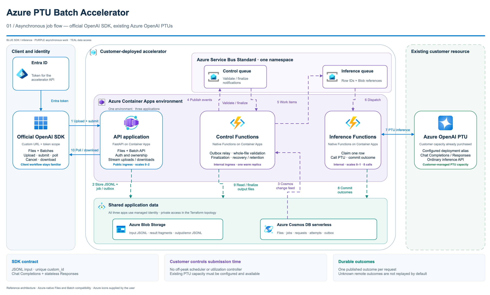
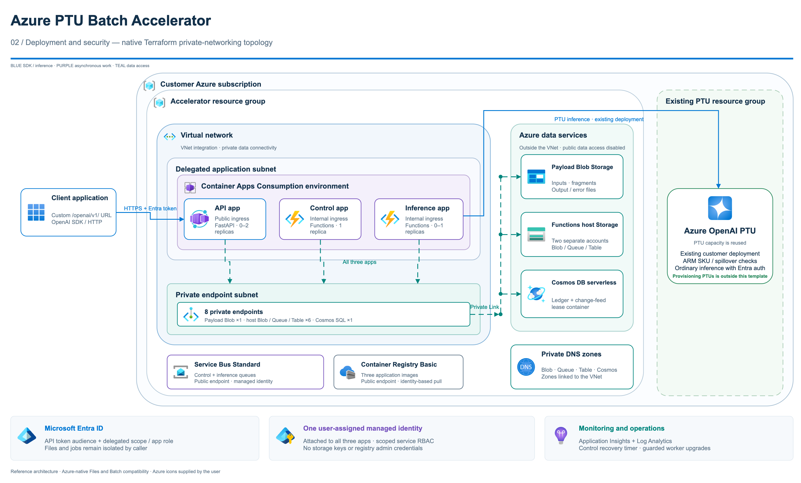

# Azure PTU Batch Accelerator

An open-source, OpenAI Files/Batch-compatible API for running asynchronous JSONL inference on **an existing Azure OpenAI provisioned throughput (PTU) deployment**. It accepts a file, records a batch, and processes rows through a bounded worker. It does not create, resize, or change the Azure OpenAI deployment.

> This is a reference accelerator, not Azure OpenAI native Batch. It has no Azure OpenAI Batch portal integration, native Batch pricing or SLA, guaranteed 24-hour completion, or automatic capacity scheduling. You pay for the PTU deployment and the accelerator's Azure resources. Review [limits and operations](docs/operations.md) before production use.

## Architecture

The accelerator keeps the OpenAI SDK's Files and Batch workflow while processing requests on the customer's existing Azure OpenAI PTU deployment.



[View job flow at full size](docs/architecture/azure-ptu-batch-workflow.png) · [Download editable Draw.io diagram](docs/architecture/azure-ptu-batch-architecture.drawio) · [Download architecture PDF](docs/architecture/azure-ptu-batch-architecture.pdf)

<details>
<summary>Deployment and security topology</summary>



[View deployment and security diagram at full size](docs/architecture/azure-ptu-batch-deployment.png)

</details>

All three apps share one Azure Container Apps Consumption environment. Control and inference use native Azure Functions container apps (`kind: functionapp`), not Durable Functions or sandbox containers. The API is a regular FastAPI container app. A user-assigned managed identity reaches Storage, Service Bus, Cosmos DB, Azure Monitor, ACR, and the existing Azure OpenAI account. The customer owns the Entra API registration and caller grants.

## Local quickstart

Requires Python 3.12 and [uv](https://docs.astral.sh/uv/). The local mode uses in-memory state and an echo inference path. It makes no Azure calls and **is not durable**.

```bash
uv sync --locked --all-extras
PTU_BATCH_MODE=local uv run --locked --all-extras uvicorn ptu_batch.api:app --host 127.0.0.1 --port 8000
```

Set the OpenAI SDK's `base_url` to `http://127.0.0.1:8000/openai/v1/` and use `local-dev-token` as the API key. [The SDK example](examples/openai_client.py) uploads a JSONL file, creates a batch, checks status, downloads output, and cancels. Local mode is for shape and workflow tests; it is not a throughput or persistence simulation.

```bash
uv run --locked --all-extras ptu-batch demo
uv run --locked --all-extras ptu-batch export-openapi --output openapi.json
```

To run the shipped SDK example against the local server from a second terminal:

```bash
uv run --locked --all-extras python examples/openai_client.py
```

## Azure deployment

Follow the [deployment guide](docs/deployment.md). It covers the existing PTU deployment checks, customer-owned Entra API registration, `azd env set` values, provisioning, deployment, and the durable inference drain gate. `azd provision` creates the accelerator resources and role assignments; it does not create an Azure OpenAI deployment. Azure admission starts paused and must be resumed explicitly after deployment checks. Local mode starts unpaused. Cloud acceptance and billable smoke tests are opt-in.

## Terraform deployment

A native AzureRM/AzAPI template is available in [infra/terraform](infra/terraform/README.md). It provisions the same Container Apps and Functions architecture and builds/pushes the images through the Terraform dependency graph. Use the [Terraform deployment guide](docs/terraform-deployment.md) for private state handling, safe applies, and the explicit infrastructure-only validation option when no PTU is available.

## API shape

The OpenAI SDK base URL is `{API_ENDPOINT_URL}/openai/v1/`. Supported operations include `files.create`, `files.content`, `batches.create`, `batches.retrieve`, `batches.list`, and `batches.cancel`. JSONL rows use `/v1/chat/completions` or `/v1/responses`, with `body.model` set to the configured public alias. Batch creation accepts `/chat/completions` or `/responses` as the advisory endpoint (also accepting `/v1/...` forms). See [chat](examples/chat.jsonl) and [Responses](examples/responses.jsonl) examples.

| Capability | Status |
| --- | --- |
| Chat Completions and Responses JSONL | Supported for configured existing PTU deployment |
| Files and Batch create/list/retrieve/cancel/content | Supported subset |
| JSONL input | At most 200 MB and 100,000 lines per batch |
| Completion window | `24h` target; work may continue after the target |
| Native Azure OpenAI Batch portal, pricing, SLA | Unsupported |
| BYOS, embeddings, stream, background mode | Unsupported |
| Stateful tools or cross-row state | Unsupported |
| Reuse of remote file IDs as input | Unsupported |
| Automatic scheduling or idle-PTU detection | Unsupported |

Unknown inference outcomes are recorded and are **not replayed by default**, to avoid duplicate charges or effects. Cancel is cooperative; a request already running is not preempted. See the [recovery runbook](docs/operations.md).

The `ptu-batch usage` operator command reports known tokens. Optional comparison rates and infrastructure spend must be supplied by the operator; it does not fetch prices. See [usage reporting](docs/operations.md#usage-report).

## Security and cost

Azure mode requires an Entra bearer token with the `Batch.ReadWrite` delegated scope or `Batch.ReadWrite.Application` application role, validates the configured audience and tenant, and uses managed identity for Azure services. Internal workers have internal ingress. The storage accounts disable shared keys and public blobs; Cosmos DB and Service Bus disable local auth. The Bicep baseline uses public service endpoints. Terraform defaults to VNet-integrated compute with private Storage/Cosmos endpoints and private DNS; ACR and Service Bus remain public and authenticated. The customer's network and egress controls remain their responsibility; private connectivity to the existing PTU account must also be configured when required. Service Bus private endpoints require Premium rather than the baseline Standard tier.

Container Apps, Service Bus Standard, Cosmos DB serverless, Storage, ACR, logging, and the existing PTU all incur charges. Control keeps one warm replica for its Cosmos change feed and recovery timer. API and inference can scale to zero, but the other charges remain. Restrict resource and data retention to the customer's policy before production use.

## Development

See [CONTRIBUTING.md](CONTRIBUTING.md), [SECURITY.md](SECURITY.md), and the [MIT license](LICENSE). This project is not a Microsoft product or endorsement.
